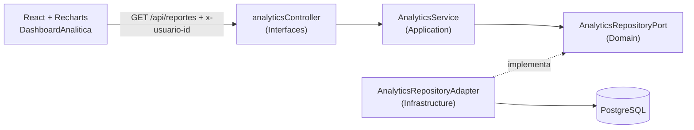

# Subsistema de Analítica y Reportes

Extensión de `market-taller` que agrega un módulo de analítica de ventas respetando la arquitectura hexagonal. Todas las métricas se calculan **en PostgreSQL** (SUM, COUNT, AVG, GROUP BY, `date_trunc`, `generate_series`); Node solo recibe resultados ya agregados.

## 1. Arquitectura



| Capa | Archivo | Responsabilidad |
|---|---|---|
| Domain | `src/domain/analyticsRepositoryPort.js` | Contrato de consultas analíticas |
| Application | `src/application/analyticsService.js` | Valida rango, límite y agrupación; orquesta el resumen |
| Infrastructure | `src/infrastructure/analyticsRepositoryAdapter.js` | Consultas SQL con agregaciones |
| Interfaces | `src/interfaces/analyticsController.js` | Rutas HTTP y guard de administrador |

La inyección de dependencias se hace en `src/server.js` (composition root).

## 2. Especificación de endpoints

Base: `/api/reportes`. **Solo administradores.**

**Autorización:** header `x-usuario-id: <id>`. El backend verifica en la base de datos que el usuario sea `admin` con estado `aprobado`. Si no, responde `403`.

**Parámetros comunes (query):**

| Parámetro | Tipo | Default | Descripción |
|---|---|---|---|
| `desde` | `YYYY-MM-DD` | hoy − 29 días | Inicio del rango (inclusivo) |
| `hasta` | `YYYY-MM-DD` | hoy | Fin del rango (inclusivo) |
| `agrupacion` | `dia` \| `semana` \| `mes` | `dia` | Solo en `/ingresos` y `/` |
| `limite` | entero 1–20 | `5` | Solo en `/productos-top` y `/` |

| Método | Ruta | Descripción |
|---|---|---|
| GET | `/api/reportes` | Resumen completo (una sola petición para el dashboard) |
| GET | `/api/reportes/productos-top` | Top N productos más vendidos (unidades e ingresos) |
| GET | `/api/reportes/ingresos` | Ingresos por día, semana o mes (rellena con 0 los periodos sin ventas) |
| GET | `/api/reportes/estados` | Distribución de pedidos por estado (cantidad y porcentaje) |
| GET | `/api/reportes/ticket-promedio` | Ticket promedio por pedido y por usuario, más ranking de clientes |

### Ejemplo: `GET /api/reportes/productos-top?limite=5&desde=2026-09-01&hasta=2026-10-11`

```json
{
  "rango": { "desde": "2026-09-01", "hasta": "2026-10-11" },
  "limite": 5,
  "datos": [
    { "id": 2, "nombre": "Producto", "unidades": 40, "ingresos": 1200.0 }
  ]
}
```

### Ejemplo: `GET /api/reportes/estados`

```json
{
  "rango": { "desde": "2026-09-12", "hasta": "2026-10-11" },
  "datos": [
    { "estado": "enviado", "cantidad": 26, "porcentaje": 39.4 }
  ]
}
```

### Códigos de respuesta

| Código | Significado |
|---|---|
| `200` | Éxito |
| `400` | Fechas inválidas, `desde` > `hasta`, rango mayor a 2 años o agrupación inválida |
| `403` | Usuario sin rol de administrador aprobado (o sin header) |
| `500` | Error interno |

## 3. Reglas de negocio de las métricas

- **Ingresos** y **top de productos**: cuentan solo pedidos `pagado`, `confirmado` y `enviado`. Los `pendiente_de_pago` y `cancelado` no suman dinero.
- **Distribución de estados**: cuenta todos los pedidos del rango (incluye pendientes y cancelados).
- **Ticket promedio por pedido**: `AVG(total)` de pedidos con ingreso.
- **Ticket promedio por usuario**: `SUM(total) / COUNT(DISTINCT usuario_id)`, más el ranking de los 10 mejores clientes.
- Se agregó el estado `enviado` a `ESTADOS_VALIDOS` del dominio.

## 4. Frontend

- `src/DashboardAnalitica.jsx`: gráfica de **barras o línea** de ingresos, **pastel** de estados, **tabla** de top productos, tarjetas de KPIs y tabla de ticket por usuario.
- **Filtros dinámicos:** "Últimos 7 días", "Últimos 30 días", "Este mes", rango personalizado, agrupación por día, semana o mes, y Top 5 o 10.
- `src/PanelAdmin.jsx`: pestañas **Gestión** y **Analítica**; solo se muestra al rol `admin`.
- Librería de gráficas: **Recharts**.

## 5. Nota de seguridad

El proyecto no tiene sesiones con token. El acceso se restringe validando el `id` del usuario contra la base de datos en cada petición. Es una protección simplificada, porque el header podría falsificarse. La mejora natural es emitir un **JWT** firmado al hacer login y verificarlo en un middleware.

## 6. Datos de demostración

`backend/seed_pedidos_demo.sql` inserta 60 pedidos aleatorios de los últimos 45 días, usando productos y usuarios aprobados.

```bash
psql -U apiuser -d market_db -h localhost -f seed_pedidos_demo.sql
```


