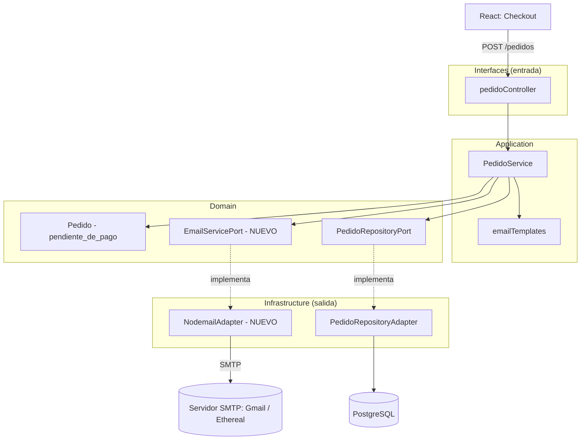

# Subsistema de notificaciones por correo

El sistema no procesa pagos en línea. Cada pedido se registra como
`pendiente_de_pago` y dispara dos correos: uno al cliente con el desglose y los
datos bancarios, y otro al administrador avisando del pedido nuevo.

## 1. Diagrama de arquitectura actualizado

`PedidoService` solo conoce `EmailServicePort`. Nodemailer se importa
únicamente en `NodemailAdapter`, y el proveedor de correo se elige con
variables de entorno (`SMTP_*`), sin tocar el dominio ni la lógica del pedido.

## 2. Código fuente

| Capa | Archivo |
|---|---|
| Domain (puerto) | `backend/src/domain/emailServicePort.js` |
| Domain (entidad) | `backend/src/domain/pedido.js` |
| Application | `backend/src/application/pedidoService.js` |
| Application (plantillas) | `backend/src/application/emailTemplates.js` |
| Infrastructure (adaptador) | `backend/src/infrastructure/nodemailAdapter.js` |
| Infrastructure (repositorio) | `backend/src/infrastructure/pedidoRepositoryAdapter.js` |
| Interfaces | `backend/src/interfaces/pedidoController.js` |
| Composition root | `backend/src/server.js` |
| Frontend (checkout) | `frontend/src/DashboardPedido.jsx` |

## 3. Evidencia de pruebas de envío

### Checkout en React

### Pedido registrado

### Backend enviando los correos

### Correo recibido por el cliente (desglose y datos bancarios)

### Correo recibido por el administrador

### Pedido guardado en PostgreSQL con estado pendiente_de_pago

### Pruebas con bandeja de pruebas (Ethereal)

